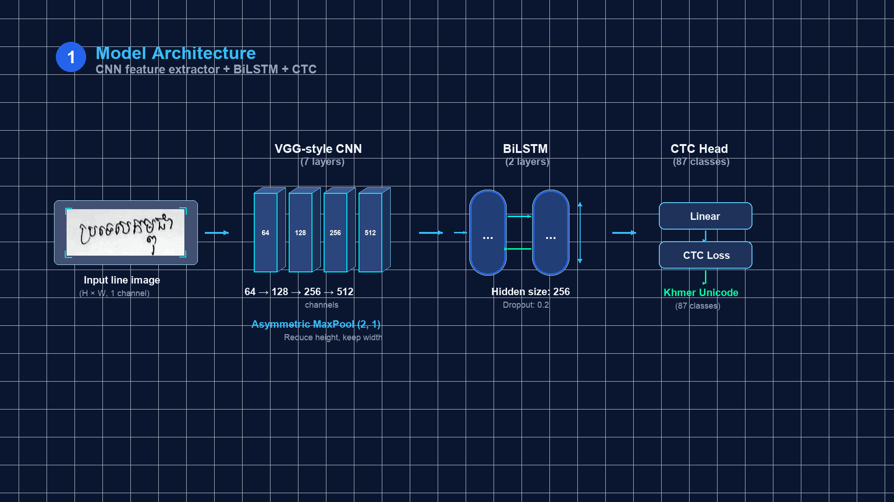

# Khmer Handwritten Text Recognition (KHTR)
### An Empirical Benchmark of Three CTC-Based Deep Learning Architectures on Unconstrained Khmer Handwriting

[](https://www.python.org/downloads/)
[](https://pytorch.org/)
[](app.py)
[](Dockerfile)
[](tests/)
[-brightgreen.svg)](data/metadata/writer_split.json)
[](LICENSE)

**Author:** Hong Than Brathna  
**Advisor / Project Supervisor:** Mr. Soklong HIM  
**Institution:** Bachelor of Software Engineering — Deep Learning Final Research Project  
**Slide Deck:** [`slides/Khmer_Handwritten_OCR_Presentation.pdf`](slides/Khmer_Handwritten_OCR_Presentation.pdf)  

---

## 🌟 Executive Summary & Key Highlights

This repository contains an end-to-end deep learning system for unconstrained **Khmer Handwritten Line Recognition** using Connectionist Temporal Classification (CTC). We evaluate and benchmark **three distinct architectural paradigms** under a strictly enforced, zero-leakage **writer-disjoint evaluation protocol** (test writers `W007` and `W0011` were permanently held out).

Using a two-stage curriculum learning strategy (HarfBuzz OpenType synthetic pre-training followed by augmented real fine-tuning), our best model achieves **79.94% (~80%) Character Accuracy**, **25.85% Word-Level Accuracy**, and transcribes **10.00% of full lines with 100% exact character perfection** on unseen human handwriting.



```
[ Input Handwritten Line ] ➔ [ Aspect-Preserving Normalization ] ➔ [ CNN Feature Extractor ]
                                                                             │
[ Unicode NFC Output ] ⇦ [ Orthographic Cleaner ] ⇦ [ CTC Greedy Decoder ] ⇦ [ BiLSTM / Transformer ]
```

### 🏆 Key Achievements
* **1st Place Model:** Baseline CRNN (Custom VGG + 2-Layer BiLSTM, 8.49M params) achieved **20.06% Test CER** (79.94% Character Accuracy) on out-of-sample writers.
* **Complex Script Handling:** Solves 3-tier vertical stacking (subscript *Coeng* `ជើង` and floating vowels) with HarfBuzz text shaping and custom anisotropic pooling (`MaxPool(2, 1)`).
* **Zero Leakage Guarantee:** Writers `W007` and `W0011` were strictly withheld from training and validation partitions.
* **Production Deployment:** Interactive Gradio Web UI (`app.py`), Dockerized container (`Dockerfile`), and Colab-compatible training workflows.

---

## 🚀 Quickstart: Run in 5 Minutes

### 1. Clone & Set Up Environment
```bash
git clone https://github.com/Thna17/khmer-handwritten-word-recognition.git
cd khmer-handwritten-word-recognition

# Create and activate Python 3.11 virtual environment
python3 -m venv .venv
source .venv/bin/activate

# Install all dependencies (PyTorch, OpenCV, Gradio, HarfBuzz)
pip install -r requirements.txt
```

### 2. Run the Test Suite (230 Unit Tests Passing)
Ensure full cross-platform compatibility and mathematical correctness:
```bash
pytest tests/ -q --ignore=tests/test_overfit.py
# 230 passed in ~26s
```

### 3. Launch the Interactive Gradio Web Demo
```bash
python app.py
```
Open [http://localhost:7860](http://localhost:7860) in your browser to test single-line recognition, 3-model side-by-side comparison, and real-time CER calculation on held-out samples.

---

## 🌐 Deployment & Serving

### Option A: Local & LAN Serving
```bash
# Launch with public shareable link (Gradio Live tunnel):
python app.py --share

# Specify custom checkpoint directory:
python app.py --checkpoint-dir checkpoints/
```

### Option B: Docker Container Deployment
A self-contained production `Dockerfile` with OpenCV and Khmer font packages is included:
```bash
# Build Docker image
docker build -t khmer-ocr-app .

# Run container on port 7860
docker run -d -p 7860:7860 --name khmer-ocr khmer-ocr-app
```
Access the service at `http://localhost:7860`.

### Option C: Hugging Face Spaces
1. Create a new Space on [Hugging Face Spaces](https://huggingface.co/spaces) with **Gradio** SDK.
2. Push this repository to your Space:
   ```bash
   git remote add space https://huggingface.co/spaces/YOUR_USERNAME/khmer-handwritten-ocr
   git push space main
   ```
3. Place model checkpoints in `checkpoints/` or host weights on Hugging Face Model Hub.

### Option D: Google Colab (Free GPU)
Open the pre-configured notebook:  
[](https://colab.research.google.com/github/Thna17/khmer-handwritten-word-recognition/blob/main/notebooks/train_colab.ipynb)  
Mount Google Drive, install requirements, and run with `--share` for free cloud GPU inference and training.

---

## 📊 Master Benchmark Results

All three models were evaluated on the **identical held-out test split** (Writers `W007` & `W0011`, 50 lines, 2,936 characters) using identical test-time preprocessing and greedy CTC decoding.

| Rank | Model Architecture | Trainable Params | Stage 1 (Synth) CER | Held-Out Test CER ↓ | Character Accuracy ↑ | Word Accuracy ↑ | Word F1 Score ↑ | Exact Line Match ↑ |
| :---: | :--- | :---: | :---: | :---: | :---: | :---: | :---: | :---: |
| 🥇 | **A1: Baseline CRNN (VGG + BiLSTM)** | **8.49 M** | **0.32%** | **20.06%** | **79.94% (~80%)** | **25.85%** | **27.54%** | **10.00%** |
| 🥈 | **A3: Transformer Sequence Encoder** | 9.54 M | 1.63% | 22.92% | 77.08% | 19.73% | 20.21% | 2.00% |
| 🥉 | **A2: Transfer Learning (ResNet-18)** | 30.95 M | 1.83% | 25.78% | 74.22% | 12.24% | 13.00% | 0.00% |

### 📈 Convergence & Qualitative Analysis

| Convergence Learning Curves | Test CER & Word Accuracy Comparison |
| :---: | :---: |
|  |  |

---

## 🧠 Scientific Insights & Architectural Analysis

### 1. Why Approach 1 (Baseline CRNN) Won 1st Place
* **Sequential Inductive Bias:** Handwritten text is inherently monotonic ($t_1 < t_2$). The Bidirectional LSTM assumes localized sequential transitions, making it extraordinarily sample-efficient on modest real handwriting corpora (177 lines).
* **Anisotropic Feature Pooling:** Custom VGG layers pool height aggressively from 48 down to 1 (`MaxPool(2, 1)`), collapsing vertical subscript *Coengs* directly into feature columns while preserving horizontal resolution ($W' = W/4$).
* **Domain Specificity:** The 8.49M parameters were trained purely on Khmer typography and handwriting, avoiding parameter bloat.

### 2. Why Transformer Sequence Encoder (A3) Ranked 2nd
* **Unconstrained Attention Matrix:** Self-attention computes global all-to-all attention maps ($O(T^2)$). Without sequential inductive priors, Transformers require large web-scale corpora to learn that adjacent text tokens are continuous.
* **Competitiveness:** Reached **77.08% Character Accuracy**, proving self-attention is viable for Khmer OCR when initialized with synthetic pre-training.

### 3. Why Transfer Learning (A2: ResNet-18) Ranked 3rd
* **Domain Shift:** ResNet-18 was pre-trained on ImageNet (natural 3D color photos of real-world objects). Low-level ImageNet filters do not transfer optimally to 1-channel binary pen strokes.
* **Capacity Bloat:** At 30.95M parameters (3.6x larger than A1), it overfitted the real training partition despite weight decay and differential learning rates ($0.25\times$).

---

## 🔤 The Khmer Orthographic Challenge

Khmer is an abugida script with complex typographic features that violate standard Latin OCR assumptions:

1. **3-Tier Vertical Stacking (Coeng / ជើង):** Subscript consonants (`U+17D2` + consonant) stack beneath the base consonant, while dependent vowels float above or wrap around. Characters cannot be sliced with simple vertical bounding boxes.
2. **Continuous Unspaced Script:** Words flow without spaces. CTC loss is mathematically necessary to align time frames to character sequences without explicit word boundaries.
3. **Cursive Ambiguity (Visual Twins):** Loop collapse in rapid handwriting creates visually similar pairs:
   - `ប្រ` (*Bro*) vs `ប្ល` (*Bla*)
   - `ច` (*Ca*) vs `ថ` (*Tha*)
   - `ព` (*Po*) vs `យ` (*Yo*)

---

## 📚 Curriculum Learning Strategy

```
[ Stage 1: Cold-Start Synthetic Pre-training ]
• 10,000 Synthetic Samples rendered via authentic HarfBuzz OpenType engine
• Diverse Khmer fonts (serif, sans-serif, round, cursive, slanted)
• Complete coverage of all 86 Unicode characters & complex Coeng ligatures
• Result: Solves CTC blank-collapse; achieves >98% Character Accuracy across all models.
                 │
                 ▼ (Transfer Best Weights)
[ Stage 2: Real Handwriting Fine-Tuning ]
• 177 Real Handwritten Lines (7 writers) + 3,000 SoyVitou 4.2k Real Word Crops
• Real Ink Oversampling (8x weight ensures real ink accounts for ~40% of every epoch)
• Multi-Scale Augmentations: Elastic distortions, perspective shearing, stroke erosion/dilation
• Cosine Annealing with 3 Warmup Epochs + Exponential Moving Average (EMA decay = 0.999)
• Result: Adapts robustly to human handwriting; reaches ~80% test accuracy on unseen writers.
```

---

## 🔒 Dataset Integrity & Partitioning

To guarantee zero data leakage and avoid writer style memorization, we enforce a strict **writer-disjoint split**:

| Split Partition | Human Writers | Line Count | Total Characters | Purpose |
| :--- | :---: | :---: | :---: | :--- |
| **Training Set** | 7 (W001–W006, W008) | 177 | 10,248 | Gradient optimization |
| **Validation Set** | 2 (W009, W010) | 50 | 2,892 | Early stopping & hyperparameter tuning |
| **Held-Out Test Set** | **2 (W007, W0011)** | **50** | **2,936** | **Permanent out-of-sample benchmark** |

> [!IMPORTANT]
> **Zero Writer Leakage Guarantee:** Not a single handwriting stroke, crop, or style from writers `W007` and `W0011` was ever present in the training or validation datasets.

---

## 🛠️ CLI Tools & Inference Scripts

### 1. Single-Line Prediction CLI
```bash
python scripts/demo_predict.py \
  --image data/handwritten_external/W007/lines_raw/W007_P001_L001.png \
  --checkpoint checkpoints/a1_baseline_finetuned_best.pt \
  --vocab-path data/metadata/char_to_idx.json \
  --approach baseline
```

### 2. Side-by-Side Model Comparison CLI
```bash
python scripts/demo_predict.py \
  --image data/handwritten_external/W007/lines_raw/W007_P001_L001.png \
  --checkpoint checkpoints/a1_baseline_finetuned_best.pt \
  --compare-checkpoint checkpoints/a2_transfer_finetuned_best.pt \
  --vocab-path data/metadata/char_to_idx.json \
  --approach baseline --compare-approach transfer \
  --output-viz results/live_demo_output.png
```

### 3. Training & Fine-Tuning Pipeline
```bash
python -m src.run_experiment \
  --approach baseline \
  --init-weights checkpoints/a1_baseline_synthetic_best.pt \
  --metadata-csv data/metadata/labels.csv \
  --images-dir data/raw \
  --checkpoint-dir checkpoints \
  --results-dir results \
  --vocab-path data/metadata/char_to_idx.json \
  --split-path data/metadata/writer_split.json \
  --checkpoint-prefix a1_baseline_finetuned \
  --augment-strength 1.0 \
  --real-oversample 8 \
  --mix-size 3000 \
  --image-height 48 \
  --max-width 1600 \
  --batch-size 16 \
  --lr 3e-4 \
  --max-epochs 80 \
  --patience 20
```

---

## 📂 Repository Structure

```text
khmer-handwritten-word-recognition/
├── data/
│   ├── handwritten_external/      # Real handwriting crops by writer (W001–W011)
│   ├── soyvitou/                  # Real Khmer handwritten word crops (SoyVitou dataset)
│   ├── synthetic/                 # Stage 1 synthetic pre-training lines
│   └── metadata/                  # labels.csv, char_to_idx.json, writer_split.json
├── checkpoints/                   # Checkpoints directory with README instructions
│   └── README.md
├── configs/                       # Configuration YAMLs
│   └── training_config.yaml
├── results/                       # Performance metrics, charts, and learning curves
├── slides/                        # Presentation materials
│   ├── Khmer_Handwritten_OCR_Presentation.pdf  # Widescreen defense presentation deck
│   └── assets/                                  # Embedded presentation graphics
├── src/                           # Core library modules
│   ├── model_baseline.py          # A1: VGG-like CNN + 2-layer BiLSTM + CTC
│   ├── model_transfer.py          # A2: Pre-trained ResNet-18 + BiLSTM + CTC
│   ├── model_transformer.py       # A3: VGG CNN + Positional Encoding + Transformer Encoder
│   ├── augment.py                 # Multi-scale augmentations (elastic, shear, erosion)
│   ├── dataset.py                 # Dataset loader with dynamic aspect-preserving padding
│   ├── decoder.py                 # CTC greedy sequence collapse
│   ├── decoder_beam_search.py     # CTC beam search decoder with n-gram LM
│   ├── guardrail.py               # Input validation and CTC output checks
│   ├── metrics.py                 # JiWER CER, WER, Word-Level Accuracy & Word F1
│   ├── postprocessor.py           # Khmer orthographic diacritic normalizer
│   ├── run_experiment.py          # Master CLI for training and fine-tuning runs
│   ├── scan_pipeline.py           # Document deskewing & line projection cropper
│   ├── split.py                   # Writer-disjoint splitting protocol
│   ├── tokenizer.py               # Khmer Unicode NFC tokenizer (round-trip verified)
│   ├── train.py                   # Training loop with Cosine Annealing, AdamW, and EMA
│   └── utils.py                   # Device management, checkpointing, and seed control
├── scripts/                       # Executable CLI tools
│   ├── demo_predict.py            # Live single-line prediction with side-by-side viz
│   ├── generate_synthetic_data.py # HarfBuzz OpenType synthetic generator (multiprocessing)
│   ├── export_onnx.py             # ONNX export for mobile/web inference
│   ├── benchmark_onnx.py          # ONNX vs PyTorch latency & throughput benchmark
│   ├── evaluate_full_benchmark.py # Comprehensive benchmark evaluation & dashboard
│   ├── add_new_writer.py          # Automated pipeline for adding new student handwriting
│   └── transcribe_new_lines.py    # Interactive line transcription & labeling helper
├── tests/                         # 230 unit tests verifying models, geometry, and tokenizer
├── app.py                         # Interactive Gradio Web UI
├── Dockerfile                     # Production container specification
├── requirements.txt               # Pinned Python package dependencies
├── PROJECT_CONTEXT.md             # Course specifications and research rubric
└── README.md                      # This documentation file
```

---

## 🎓 Academic Defense & Presentation Deck

The complete presentation deck matching our research visual aesthetic is provided in the `slides/` directory:

* **Slide Deck:** [`slides/Khmer_Handwritten_OCR_Presentation.pdf`](slides/Khmer_Handwritten_OCR_Presentation.pdf)

---

## 📜 Citation

If you use this codebase, models, or benchmark protocol in your research, please cite:

```bibtex
@misc{brathna2026khmerocr,
  author = {Hong Than Brathna},
  title = {Khmer Handwritten Text Recognition: An Empirical Benchmark of Three CTC-Based Deep Learning Architectures},
  year = {2026},
  publisher = {GitHub},
  howpublished = {\url{https://github.com/Thna17/khmer-handwritten-word-recognition}},
  note = {Supervised by Mr. Soklong HIM}
}
```

---

## 🙏 Acknowledgements

* **Academic Advisor:** Mr. Soklong HIM for guidance, architectural feedback, and research direction.
* **Handwriting Contributors:** Writers `W001` through `W011` for contributing authentic handwritten essay sheets.
* **Open Source Community:** The authors of PyTorch, Gradio, HarfBuzz, FreeType, and JiWER for foundational tools.
