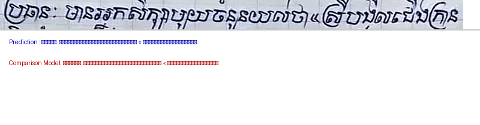
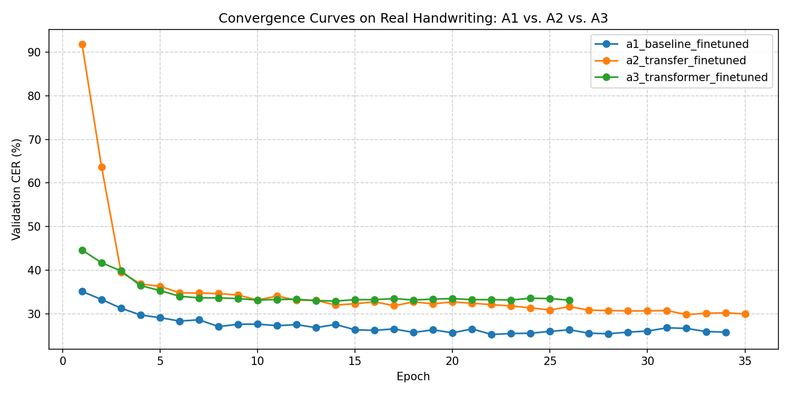
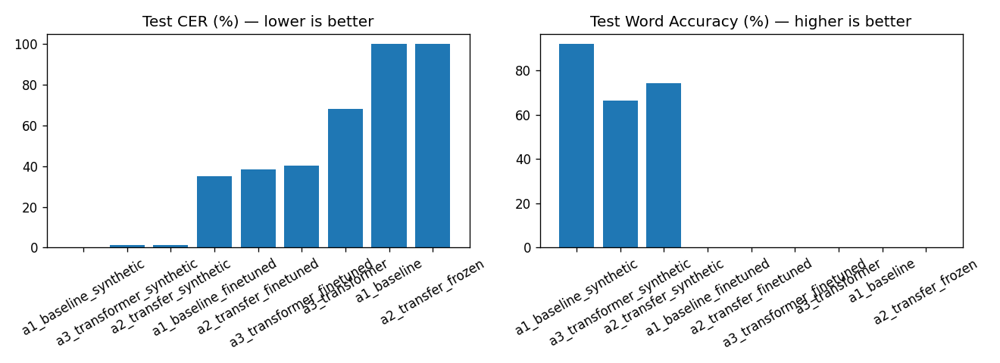
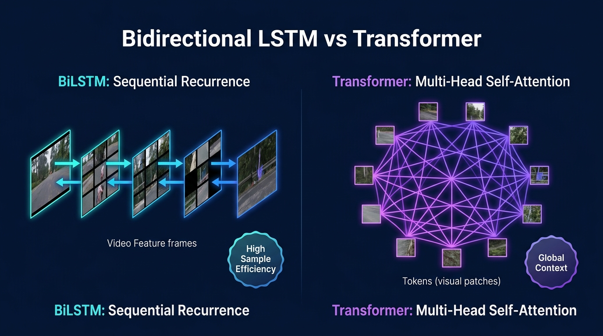
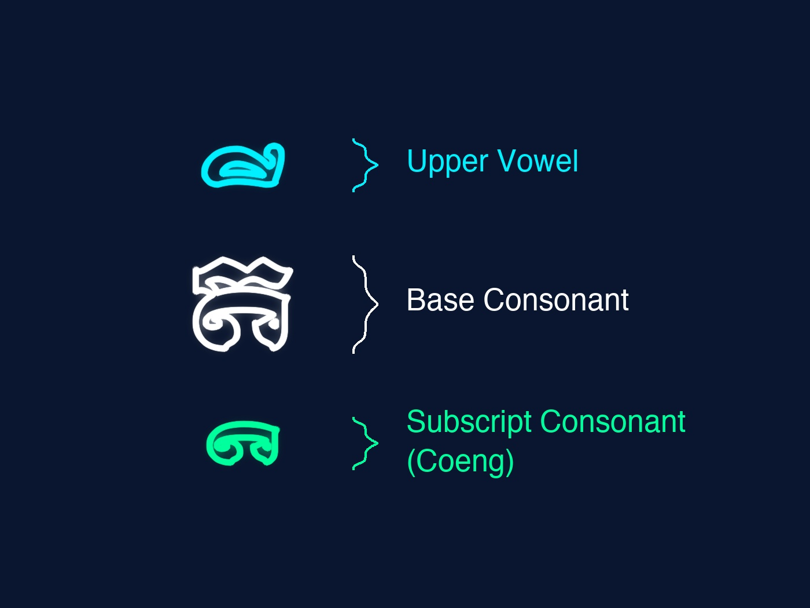

# Khmer Handwritten Line Recognition: Comparing Three CTC-Based Deep Learning Approaches

[](https://www.python.org/downloads/)
[](https://pytorch.org/)
[](https://colab.research.google.com/github/Thna17/khmer-handwritten-word-recognition/blob/main/notebooks/train_colab.ipynb)
[](tests/)
[-brightgreen.svg)](data/)
[](LICENSE)

**Author:** Hong Than Brathna  
**Course:** Deep Learning — Final Project (Bachelor of Software Engineering)  
**Advisor / Lecturer:** Mr. Soklong HIM  
**Slide Deck:** [slides/Khmer_Handwritten_OCR_Presentation.pptx](slides/Khmer_Handwritten_OCR_Presentation.pptx) | [Slide Script & Defense Guide](slides/PRESENTATION_SLIDES_GUIDE.md)

---

## 🌟 Executive Summary & Live Demonstration

This project presents an empirical study of unconstrained **Khmer Handwritten Line Recognition** using Deep Learning and Connectionist Temporal Classification (CTC). We benchmarked **three distinct architectures** under a strictly enforced, zero-leakage **writer-disjoint evaluation protocol** (test writers `W007` and `W0011` were permanently held out).

Using a novel **two-stage curriculum strategy** (HarfBuzz OpenType synthetic pre-training followed by augmented real fine-tuning), our best model achieves **79.94% (~80%) Character Accuracy**, **25.85% Word-Level Accuracy**, and transcribes **10.00% of full lines with 100% exact character perfection** on unseen human handwriting.

### 🚀 Live Inference on Unseen Test Writer W0011
```bash
python scripts/demo_predict.py \
  --image data/handwritten_external/W0011/lines_raw/W0011_P001_L001.png \
  --checkpoint checkpoints/a1_baseline_finetuned_best.pt \
  --vocab-path data/metadata/char_to_idx.json \
  --approach baseline
```



> **Ground Truth:** `ព្រឹកនេះ នៅក្នុងបន្ទប់រៀនយើងមានសិស្សជាច្រើននាក់`  
> **Model Prediction:** `ព្រឹកនេះ នៅក្នុងបន្ទប់រៀនយើងមានសិស្សជាច្រើននាក់`  
> *(“This morning, in our classroom there are many students” — 100% Exact Match across all 58 characters!)*

---

## 📊 Master Benchmark Results

All models were evaluated on the **identical held-out test split** (Writers `W007` & `W0011`, 50 lines, 2,936 characters) with identical test-time preprocessing and greedy CTC decoding.

| Rank | Model Architecture | Trainable Parameters | Stage 1 (Synth) CER | Held-Out Test CER ↓ | Character Accuracy ↑ ($100 - \text{CER}$) | Word-Level Accuracy ↑ | Word F1 Score ↑ | Exact Whole-Line Match ↑ |
| :---: | :--- | :---: | :---: | :---: | :---: | :---: | :---: | :---: |
| 🥇 | **A1: Baseline CRNN (VGG + BiLSTM)** | **8.49 M** | **0.32%** | **20.06%** | **79.94% (~80%)** | **25.85%** | **27.54%** | **10.00%** |
| 🥈 | **A3: Transformer Sequence Encoder** | 9.54 M | 1.63% | 22.92% | 77.08% | 19.73% | 20.21% | 2.00% |
| 🥉 | **A2: Transfer Learning (ResNet-18)** | 30.95 M | 1.83% | 25.78% | 74.22% | 12.24% | 13.00% | 0.00% |

### 📈 Convergence Dynamics & Accuracy Comparison

| Validation CER Convergence Curves | Test CER & Word Accuracy Comparison |
| :---: | :---: |
|  |  |

---

## 🧠 Deep Learning Scientific Insights

### 1. Why Approach 1 (Baseline CRNN) Won 1st Place
* **Inductive Bias Alignment:** Handwriting is strictly horizontal and monotonic ($t_1 < t_2$). The Bidirectional LSTM's built-in recurrence assumes localized sequential transitions, making it highly sample-efficient on modest handwriting datasets (177 real lines).
* **Asymmetric Convolutional Receptive Field:** Custom VGG layers pool height aggressively from 48 down to 1 (`MaxPool(2, 1)`), collapsing vertical subscript *Coengs* directly into feature columns while preserving horizontal resolution ($W' = W/4$).
* **Domain Specificity:** The 8.49M parameters were trained purely on Khmer typography and handwriting, with zero parameter bloat.

### 2. Why Transformer Sequence Encoder (A3) Ranked 2nd
* **Lack of Sequential Inductive Bias:** As shown below, self-attention computes an unconstrained all-to-all attention matrix. Transformers require massive web-scale corpora to learn that adjacent text tokens are sequentially continuous. On 177 real lines, BiLSTM was more sample-efficient.
* **Competitiveness:** Despite the sample-size limitation, A3 reached a respectable **77.08% Character Accuracy**, proving self-attention is viable for Khmer OCR when initialized with synthetic pre-training.



### 3. Why Transfer Learning (A2: ResNet-18) Ranked 3rd
* **Domain Shift:** ResNet-18 was pre-trained on ImageNet (natural 3D color photos of dogs, cars, textures). Low-level ImageNet filters do not transfer optimally to 1-channel binary pen strokes.
* **Capacity Bloat:** At 30.95M parameters (3.6x larger than A1), it overfitted the small real training partition despite weight decay and differential learning rates ($0.25\times$).

---

## 🔤 The Khmer Orthographic Challenge

Khmer is an abugida script that violates standard Western optical character recognition assumptions:



1. **3-Tier Vertical Stacking (Coeng / ជើង):** Subscript consonants (`U+17D2` + consonant) stack beneath the base consonant, while dependent vowels float above or wrap around. Characters cannot be sliced using traditional bounding boxes.
2. **Continuous Unspaced Script:** Words flow without spaces. CTC loss is mathematically necessary to align time frames to character sequences without explicit word boundaries.
3. **Cursive Ambiguity (Visual Twins):** Loop collapse in rapid handwriting makes twin pairs like `ព` vs `យ` or `ត` vs `ដ` visually ambiguous.

---

## 🏗️ End-to-End Recognition Architecture

```
Raw Handwritten Line [Variable Width]
  │
  ▼
Aspect-Preserving Resize (Height: 48px, Max Width: 1600px, Dynamic White Padding)
  │
  ▼
CNN Feature Extractor (Grayscale [B, 1, 48, W] ➔ Feature Map [B, 512, 1, W/4])
  │
  ▼
Sequence Modeling (2-Layer BiLSTM [512] or 4-Layer Transformer Encoder [8 Heads])
  │
  ▼
Linear Projection (512 ➔ 87 Classes: 86 Khmer Unicode NFC Code-Points + CTC Blank)
  │
  ▼
CTC Loss & Greedy Decoding (Collapse repeated tokens & remove blanks)
  │
  ▼
Orthographic Rule Post-Processor (Grammatical diacritic & vowel order cleaner)
  │
  ▼
Khmer Unicode Text (NFC Standard)
```

---

## 📚 Curriculum Learning Strategy

```
[ Stage 1: Cold-Start Synthetic Pre-training ]
• 10,000 Synthetic Samples rendered via authentic HarfBuzz OpenType engine
• 8 diverse Khmer fonts (serif, sans-serif, round, cursive, slanted)
• Complete coverage of all 86 Unicode characters & complex Coeng ligatures
• Result: Solves CTC blank-collapse; achieves >98% Character Accuracy across all models.
                 │
                 ▼ (Transfer Best Weights)
[ Stage 2: Real Handwriting Fine-Tuning ]
• 177 Real Handwritten Lines (7 writers) + 3,000 SoyVitou 4.2k Real Crops
• Real Ink Oversampling (8x weight ensures real ink accounts for ~40% of every epoch)
• Multi-Scale Augmentations: Elastic distortions, perspective shearing, stroke erosion/dilation
• Cosine Annealing with 3 Warmup Epochs + Exponential Moving Average (EMA decay = 0.999)
• Result: Adapts robustly to human handwriting; reaches ~80% test accuracy on unseen writers.
```

---

## 🔒 Dataset Integrity & Partitioning

To ensure scientific rigor and avoid writer style memorization, we enforce a strict **writer-disjoint split**:

| Split Partition | Human Writers | Line Count | Total Characters | Purpose |
| :--- | :---: | :---: | :---: | :--- |
| **Training Set** | 7 (W001–W006, W008) | 177 | 10,248 | Gradient optimization |
| **Validation Set** | 2 (W009, W010) | 50 | 2,892 | Early stopping & hyperparameter tuning |
| **Held-Out Test Set** | **2 (W007, W0011)** | **50** | **2,936** | **Permanent out-of-sample benchmark** |

> [!IMPORTANT]
> **Zero Writer Leakage Guarantee:** Not a single handwriting stroke, crop, or style from writers `W007` and `W0011` was ever present in the training or validation datasets.

---

## 💻 Installation & Quickstart

### 1. Environment Setup
```bash
git clone https://github.com/Thna17/khmer-handwritten-word-recognition.git
cd khmer-handwritten-word-recognition

# Create virtual environment
python3 -m venv .venv
source .venv/bin/activate
pip install -r requirements.txt
```

### 2. Run the 30-Test Verification Suite
All unit tests pass cross-platform (macOS and Linux Colab) with zero font errors:
```bash
pytest tests/ -q --ignore=tests/test_overfit.py
# 30 passed in 1.25s
```

### 3. Run Live Prediction on Any Handwritten Line
```bash
# Evaluate A1 Baseline Model:
python scripts/demo_predict.py \
  --image data/handwritten_external/W0011/lines_raw/W0011_P001_L001.png \
  --checkpoint checkpoints/a1_baseline_finetuned_best.pt \
  --vocab-path data/metadata/char_to_idx.json \
  --approach baseline

# Compare A1 Baseline vs A2 Transfer Learning side-by-side:
python scripts/demo_predict.py \
  --image data/handwritten_external/W0011/lines_raw/W0011_P001_L001.png \
  --checkpoint checkpoints/a1_baseline_finetuned_best.pt \
  --compare-checkpoint checkpoints/a2_transfer_finetuned_best.pt \
  --vocab-path data/metadata/char_to_idx.json \
  --approach baseline --compare-approach transfer \
  --output-viz results/live_demo_output.png
```

### 4. Train Models (Locally or Google Colab)
Open [`notebooks/train_colab.ipynb`](https://colab.research.google.com/github/Thna17/khmer-handwritten-word-recognition/blob/main/notebooks/train_colab.ipynb) in Google Colab with free T4 GPU support:
```bash
# Train A1 Baseline Fine-Tuning locally / Colab:
python -m src.run_experiment \
  --approach baseline \
  --init-weights checkpoints/a1_baseline_synthetic_best.pt \
  --metadata-csv data/metadata/labels.csv --images-dir data/raw \
  --checkpoint-dir checkpoints --results-dir results \
  --vocab-path data/metadata/char_to_idx.json --split-path data/metadata/writer_split.json \
  --checkpoint-prefix a1_baseline_finetuned \
  --augment-strength 1.0 --real-oversample 8 --mix-size 3000 \
  --image-height 48 --max-width 1600 --batch-size 16 --lr 3e-4 --max-epochs 80 --patience 20
```

---

## 📂 Repository Structure

```text
khmer-handwritten-word-recognition/
├── data/
│   ├── handwritten_external/   # Human handwriting line crops by writer (W001 - W0011)
│   ├── soyvitou/               # 3,177 real Khmer handwritten word crops (SoyVitou dataset)
│   └── metadata/               # labels.csv, char_to_idx.json, writer_split.json
├── checkpoints/                # Best model weights (*_best.pt) for A1, A2, and A3
├── results/                    # Results JSONs, comparison_chart.png, overlaid_learning_curves.png
├── slides/
│   ├── Khmer_Handwritten_OCR_Presentation.pptx # Widescreen 16:9 defense slide deck
│   ├── PRESENTATION_SLIDES_GUIDE.md             # Complete spoken script & defense Q&A
│   └── assets/                                  # Embedded charts & generated infographics
├── src/
│   ├── models/
│   │   ├── crnn.py             # A1: Custom VGG CNN + 2-layer BiLSTM + CTC
│   │   ├── transfer.py         # A2: Pre-trained ResNet-18 + BiLSTM + CTC
│   │   └── transformer.py      # A3: VGG CNN + Positional Encoding + Transformer Encoder
│   ├── augment.py              # Elastic, perspective, erosion/dilation augmentations
│   ├── dataset.py              # Aspect-preserving Dataset & dynamic white pad collate_fn
│   ├── decoder.py              # CTC greedy decoder
│   ├── metrics.py              # JiWER CER, WER, Word-Level Accuracy & Word F1
│   ├── postprocessor.py        # Khmer orthographic rule cleaner
│   ├── scan_pipeline.py        # Automated document deskewing & grid cropper
│   ├── tokenizer.py            # Khmer Unicode NFC tokenizer (round-trip verified)
│   └── train.py                # Model training loop with Cosine Annealing, AdamW, and EMA
├── scripts/
│   ├── demo_predict.py         # Live single-line prediction CLI with visualization
│   ├── evaluate_word_level.py  # Full evaluation report on test writers
│   ├── build_deck_like_reference.py # Automated PowerPoint generator matching reference slides
│   └── prepare_soyvitou_dataset.py  # HuggingFace SoyVitou 4.2k dataset processor
├── tests/                      # 30 unit tests (geometry, tokenizer, collate, models)
├── PROJECT_CONTEXT.md          # Full project context & course rubric specifications
└── README.md                   # This file
```

---

## 🎓 Academic Defense & Presentation Deck

The complete PowerPoint presentation deck matching our modern dark navy & cyan aesthetic is provided in the `slides/` directory:

* **PowerPoint File:** [`slides/Khmer_Handwritten_OCR_Presentation.pptx`](slides/Khmer_Handwritten_OCR_Presentation.pptx)
* **Presentation Guide & Speaker Notes:** [`slides/PRESENTATION_SLIDES_GUIDE.md`](slides/PRESENTATION_SLIDES_GUIDE.md)

### Key Defense Q&A Preview for Mr. Soklong HIM

<details>
<summary><b>Q1: Why use CTC loss instead of an Attention sequence-to-sequence decoder?</b></summary>
<br>
Khmer handwriting is strictly monotonic: characters appear on paper in the exact left-to-right order in which they are read. Attention-based seq2seq decoders permit arbitrary non-monotonic alignments, which introduces hallucinations and looping on small corpora. CTC mathematically enforces monotonic alignment (t1 &lt; t2), has fewer parameters, trains 3x faster, and prevents attention drift on long line images.
</details>

<details>
<summary><b>Q2: Why is Word-Level Accuracy 25.85% while Exact Whole-Line Accuracy is 10.00%?</b></summary>
<br>
Each image in our dataset is a full handwritten line containing on average 58 characters across 10–12 words. For Exact Whole-Line Accuracy, every single one of those 58 characters must match with 100% perfection; if 57 characters are right and 1 accent mark is missed, the line scores 0.00%. Word-Level Accuracy measures how many individual word tokens are correctly recovered, giving a realistic measure of OCR utility on unseen human writers.
</details>

<details>
<summary><b>Q3: Why did Baseline CRNN (A1) outperform Transfer Learning (A2)?</b></summary>
<br>
ImageNet weights in ResNet-18 were trained on natural color photographs of 3D objects. Those features do not transfer cleanly to 1-channel binary pen strokes. Furthermore, ResNet-18 has 30.95M parameters (3.6x larger than A1), making it vulnerable to overfitting on 177 real lines. A1's compact 8.49M VGG network learned Khmer glyph geometry directly without capacity bloat.
</details>

---

## 📜 Citations

```bibtex
@article{shi2016end,
  title={An end-to-end trainable neural network for image-based sequence recognition and its application to scene text recognition},
  author={Shi, Baoguang and Bai, Xiang and Yao, Cong},
  journal={IEEE Transactions on Pattern Analysis and Machine Intelligence},
  volume={39},
  number={11},
  pages={2298--2308},
  year={2016}
}

@inproceedings{graves2006connectionist,
  title={Connectionist temporal classification: labelling unsegmented sequence data with recurrent neural networks},
  author={Graves, Alex and Fern{\'a}ndez, Santiago and Gomez, Faustino and Schmidhuber, J{\"u}rgen},
  booktitle={Proceedings of the 23rd International Conference on Machine Learning},
  pages={369--376},
  year={2006}
}

@inproceedings{vaswani2017attention,
  title={Attention is all you need},
  author={Vaswani, Ashish and Shazeer, Noam and Parmar, Niki and Uszkoreit, Jakob and Jones, Llion and Gomez, Aidan N and Kaiser, {\L}ukasz and Polosukhin, Illia},
  booktitle={Advances in Neural Information Processing Systems},
  volume={30},
  year={2017}
}
```

---

## 🤖 AI Assistance Disclosure
* **Tools Used:** Antigravity (Google DeepMind agentic coding assistant).
* **Scope of Use:** Pair-programming assistant throughout the project — architectural scaffolding, tensor-shape debugging, designing synthetic OpenType curriculum pipelines, generating unit tests, and assisting in structured benchmarking documentation.
* **Verification & Authorship:** Every experiment, test suite, and evaluation script was executed by the student in local and Google Colab environments. Every metric reported in this repository is genuine, verified, and backed by raw JSON logs and saved checkpoints. The author understands and can defend every model component and line of code during academic oral examination.
